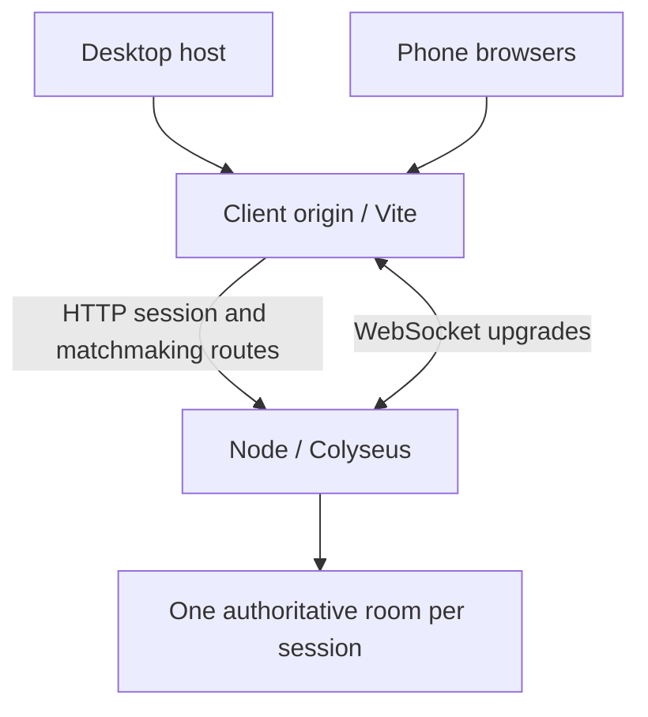

# Common Ground — Multiplayer Escape Room

Iteration 1 of a phone-controlled, real-time multiplayer browser game. A desktop host creates a room, displays a QR code, and starts the session. Up to 20 players join on phones and explore a shared top-down grid. The host sees the whole map; each player sees a camera following their character.

This is the networking and input foundation. There are **no puzzles, teams, artifacts, enemies, doors, tilemaps, or isometric graphics** in this iteration.

## Requirements and quick start

- Node.js **24 LTS**, including Corepack
- pnpm **10.34.9**, pinned in `packageManager`
- A computer and phones on the same Wi-Fi for LAN testing

From the repository root:

```sh
corepack enable
corepack prepare pnpm@10.34.9 --activate
pnpm install --frozen-lockfile
cp .env.example .env
pnpm dev
```

`pnpm dev` builds shared exports first, then runs the shared TypeScript watcher, Vite, and the Node game server together. Ctrl+C stops all three. The small Node launcher forwards optional `--port`/`--host` arguments only to Vite.

- Client: port **5173**, listening on `0.0.0.0`
- Server: port **2567**, listening on `0.0.0.0`
- Health endpoint: `/health`

On the host, open **`http://YOUR_COMPUTER_WIFI_IP:5173`**, not localhost. For example, if your computer is `192.168.1.50`, open `http://192.168.1.50:5173`. Click **Create Game**. The QR points to `/join/ROOMCODE` at this same accessible origin. A localhost QR is deliberately refused, with setup guidance displayed in its place.

On Windows, copy `.env.example` to `.env` using Explorer or `Copy-Item .env.example .env`. If `corepack enable` cannot write system shims, use a writable shim directory or invoke `corepack pnpm` directly with the shims on your PATH. No npm or Yarn install commands are used for this project.

## Real-phone test

1. Find the computer's LAN IPv4 address: `hostname -I` on Linux, `ipconfig` on Windows, or Wi-Fi settings on macOS. Choose the Wi-Fi interface, not a Docker/VPN address.
2. Permit inbound TCP **5173** on your trusted private network. Disable guest-network/AP client isolation or use a network that allows devices to communicate. The default proxy means phones do not need direct access to port 2567.
3. Open the LAN URL on the desktop. Create a game and keep the original host tab open.
4. Scan the QR with at least five phones. Use different nicknames; verify all five names appear on the host. Try a duplicate nickname, including a different letter case: it should be rejected.
5. Start the game. Turn each phone sideways. Drag the bottom-left joystick in all eight directions. Everyone should see each other, and the desktop should show the entire map with every player.
6. Keep moving at the four edges: circles must stay within the map. Try opening the join link on a new phone after starting: it should be rejected.
7. Briefly disable Wi-Fi on one phone, then restore it within 60 seconds. The character should freeze, appear faded to others, and return with its original ID, nickname, color, and position. Refresh the phone page to test stored-token reconnection too.
8. Rotate to portrait while moving, switch tabs/apps briefly, and release/cancel a touch: movement should stop. Return to landscape to continue.
9. Temporarily disconnect and reconnect the host. The host must return to the overview without creating a character. **End game** closes the room for everyone.

Test on **physical Android Chrome and iPhone Safari**. Browser emulation and Node clients do not prove iOS safe-area, touch, keyboard, or background-tab behavior. The acceptance checklist is in [docs/testing.md](docs/testing.md).

Players are designed for phones; keyboard arrows/WASD remain available for developer testing. There is no unreliable user-agent gate preventing desktop test clients.

## URLs and WebSockets

All environment settings live in the root `.env`; Vite reads them through `envDir`, and Node loads them with `--env-file-if-exists`. Restart development after changing them. `VITE_*` settings are public build-time configuration: **never put host/reconnect tokens there**.

| Setting                            | Default                 | Purpose                                                                                                  |
| ---------------------------------- | ----------------------- | -------------------------------------------------------------------------------------------------------- |
| `VITE_PUBLIC_CLIENT_URL`           | Current browser origin  | Absolute origin used in QR links, e.g. `http://192.168.1.50:5173` or an HTTPS tunnel URL                 |
| `VITE_GAME_SERVER_URL`             | Current browser origin  | Optional separate HTTP(S) or WS(S) server origin; the client derives matching HTTP and WebSocket schemes |
| `HOST`                             | `0.0.0.0`               | Node listen interface                                                                                    |
| `PORT`                             | `2567`                  | Node listen port                                                                                         |
| `DEV_SERVER_TARGET`                | `http://127.0.0.1:2567` | Vite's upstream Node server, reachable from the computer                                                 |
| `CLIENT_ORIGINS`                   | Blank                   | Exact comma-separated permitted browser origins; set this for public deployments                         |
| `DEV_ALLOWED_HOSTS`                | Blank                   | Exact allowed Vite tunnel hostnames, comma-separated                                                     |
| `DEV_HTTPS_KEY` / `DEV_HTTPS_CERT` | Blank                   | Optional local TLS certificate paths, relative to `apps/client` or absolute                              |

The default same-origin arrangement is:



Vite proxies `/api`, `/matchmake`, `/health`, and Colyseus room WebSocket paths. With a separate backend, set `VITE_GAME_SERVER_URL` to its device-accessible origin, allow its port, and configure `CLIENT_ORIGINS` to the client origin. Never put `localhost` in a phone's server URL. The client refuses mixed HTTPS-client/HTTP-server configuration. Deployment assumes the client is served at the origin root, not a URL subdirectory.

## HTTPS testing

Basic rendering, touch events, and WebSockets do not require fullscreen or a secure context. Some browser features, including clipboard access and orientation-related APIs, are restricted or vary by platform. Use trusted **HTTPS + WSS** for realistic iPhone/Android testing. The optional Expand button runs only after a user gesture and only when fullscreen is advertised; failures are harmless. Manual rotation and `100dvh`/safe-area layout are the baseline.

### Option A: temporary HTTPS tunnel

Install [Cloudflare's `cloudflared`](https://developers.cloudflare.com/tunnel/get-started/) separately, then:

```sh
pnpm dev
# In another terminal:
cloudflared tunnel --url http://localhost:5173
```

Copy the returned HTTPS hostname, then set, using the actual returned values:

```dotenv
VITE_PUBLIC_CLIENT_URL=https://YOUR-TUNNEL.trycloudflare.com
VITE_GAME_SERVER_URL=
DEV_ALLOWED_HOSTS=YOUR-TUNNEL.trycloudflare.com
CLIENT_ORIGINS=https://YOUR-TUNNEL.trycloudflare.com
```

Restart `pnpm dev` while leaving the tunnel running. Open the **HTTPS tunnel URL on the host** and create a new room. The same tunnel carries matchmaking and WebSockets, so there is no second tunnel to configure. A quick tunnel temporarily exposes this development application to anyone with its URL; stop it after testing. See [Cloudflare Quick Tunnels](https://developers.cloudflare.com/tunnel/get-started/quick-tunnels/).

### Option B: trusted local certificate

Install [mkcert](https://github.com/FiloSottile/mkcert), then substitute the computer's real LAN IP:

```sh
mkdir -p .certs
mkcert -install
mkcert -key-file .certs/lan-key.pem -cert-file .certs/lan.pem 192.168.1.50 localhost 127.0.0.1
```

Set `DEV_HTTPS_KEY=../../.certs/lan-key.pem`, `DEV_HTTPS_CERT=../../.certs/lan.pem`, `VITE_PUBLIC_CLIENT_URL=https://192.168.1.50:5173`, and `CLIENT_ORIGINS=https://192.168.1.50:5173`. Leave `VITE_GAME_SERVER_URL` blank. Restart development and open the HTTPS LAN URL.

The phones must also trust mkcert's root CA certificate. On iOS, install its certificate profile and enable full trust in **Settings → General → About → Certificate Trust Settings**. Follow the [mkcert mobile instructions](https://github.com/FiloSottile/mkcert#mobile-devices); distribute only `rootCA.pem`, **never `rootCA-key.pem`**. Certificates and keys are gitignored. Untrusted certificate warnings are not a reliable secure-context test.

## Workspace and responsibilities

```text
apps/
  client/src/
    pages/                 Home, join, lobby, and live game screens
    components/            QR, player list, Phaser lifecycle boundary
    game/
      scenes/              World camera/map and separate screen-space controls
      entities/            Colored player circles and labels
      controls/            Eight-direction joystick and throttled input sender
      network/             Colyseus connection, session tokens, snapshot buffer
    hooks/                 Routing and low-frequency connection subscriptions
  server/src/
    rooms/                 Session lifecycle, admission, host permissions
    state/                 Colyseus schemas
    systems/               Movement, identity validation, rate limiting
packages/
  shared/src/
    types/                 Renderer-independent state/input/session contracts
    constants/             World dimensions, rates, limits, colors
scripts/dev.mjs            Starts and cleans up all development processes
.github/workflows/ci.yml   Frozen install, lint, types, tests, build
```

Shared package dependencies use `workspace:*`; imports resolve to built ESM and declaration files. The root build runs in dependency order. There is exactly one `pnpm-lock.yaml`.

React owns navigation, forms, lobby/QR, and connection status. A small external store emits only roster/status changes, **never position changes**. Phaser owns rendering, cameras, the joystick, and interpolation. Phaser is loaded on entry to the game, initialized once per mounted canvas, and destroyed with its listeners and resize observer on unmount. React StrictMode is enabled.

The server owns a flat 1600 × 960 coordinate space. `WorldScene` and `PlayerEntity` interpret it visually. A future isometric projection changes the renderer and camera without replacing the input protocol or server coordinates. Collision geometry would be an intentional future server feature.

### Network and session behavior

- One private Colyseus room per session; 8-character cryptographically random room codes (~40 bits), collision checked in the single process.
- Creating a session returns a separate 256-bit host token. Only its SHA-256 digest stays on the server. Host access is checked before joining; the authorized connection alone can start the game. Tokens never enter room state or QR URLs.
- Player IDs are server-generated UUIDs. Unicode-normalized, case-insensitive nicknames are unique, including disconnected reserved seats. Each player receives a unique color from the 20-color palette; names also identify players.
- Capacity is 20 player characters **plus one host connection**. Both admission and join commit validate status/capacity/nickname to handle concurrent requests. No new players after start; valid reconnections remain possible.
- Simulation uses a fixed **30 Hz** step; state patches run at **20 Hz**. Direction input is sent at up to **20 Hz** while moving and on stop. The server rejects invalid/non-finite/out-of-range directions and replayed sequence numbers, normalizes diagonals, clamps boundaries, limits input rate, and expires input after **300 ms**.
- Remote rendering interpolates snapshots approximately **100 ms** behind receipt. Local rendering follows the latest authoritative state with short smoothing. There is no client prediction in this iteration, so higher latency is noticeable.
- Colyseus issues and rotates reconnect tokens. SDK retries recover brief drops; a tab-scoped sessionStorage token supports page reloads for up to **60 seconds after disconnection**. Tokens are bound to the originating server and role. Only the live browser tab holds the host secret; another tab cannot gain host access from a room code.
- Input resets on blur, visibility changes, touch cancellation, portrait rotation, and disconnect. The server's timeout provides a fallback when a suspended browser cannot send a stop.
- Deliberate departure removes the player. Temporary drops preserve/fade the character. Losing the host beyond the grace window ends the room; clicking End game ends it immediately. Unclaimed rooms expire after roughly 65 seconds, idle rooms after 30 minutes, and all rooms after 4 hours.
- HTTP game creation and room lookup are rate-limited, room count is capped at 100, WebSocket messages are capped at 2 KB, and public generic room creation is disabled. This is a trusted-group MVP, not a complete internet abuse-prevention system. Put public deployments behind TLS and infrastructure-level connection/request limits.

`express` is installed because the chosen Colyseus WebSocket transport imports it at runtime as a peer. The application mounts a small Node-compatible HTTP handler through Colyseus's Express hook so application and matchmaking routes share one server without competing request listeners.

## Checks and build

```sh
pnpm lint
pnpm typecheck
pnpm test
pnpm build
```

`pnpm format` formats the workspace. Tests use Node's test runner and real Colyseus WebSocket clients, including five simultaneous players, 20-player capacity, unauthorized starts, duplicate names, untrusted inputs, delayed-input stopping, host/player reconnection, and disposal. Pure tests cover boundary movement, safe spawns, normalization, token comparison, and rate limiting.

CI runs these checks on pushes and PRs to `main`. Repository publication and hosted CI execution are distinct from running the checks locally; see [docs/testing.md](docs/testing.md) for the actual verification record.

### Run a production build locally

```sh
pnpm build
NODE_ENV=production pnpm start
```

In PowerShell, set `$env:NODE_ENV='production'` before `pnpm start`. Node serves both `apps/client/dist` and Colyseus on port 2567. Open the LAN IP at port 2567, or terminate HTTPS at a reverse proxy with WebSocket upgrades enabled. Build with a matching public client URL, or keep it blank to use the origin dynamically. This requires a persistent Node process; static-only hosting/GitHub Pages and request-only serverless functions cannot host this game server.

## Limitations and Iteration 2

State is in memory. A server restart ends all games, and tokens do not survive it. Reconnection after 60 seconds or from another browser is intentionally unsupported. Single-process hosting only; scaling would need shared matchmaking/presence and room-aware routing. There is no player collision, moderation UI, persistent identity, or native-app installation. Twenty colors are not equally distinguishable to everyone, so nicknames remain visible.

For Iteration 2, first test physical phones on the intended Wi-Fi and tune input feel; add local prediction/reconciliation if needed. Then introduce an isometric rendering projection and server-owned collision geometry. After those are stable, plan team assignment and a single cooperative puzzle with server-validated interactions. None of these gameplay features is implemented here.

Reference APIs: [Colyseus 0.17 reconnection](https://0-17.docs.colyseus.io/room/reconnection), [Vite server/proxy configuration](https://vite.dev/config/server-options.html), [Screen orientation support](https://developer.mozilla.org/en-US/docs/Web/API/ScreenOrientation/lock).
