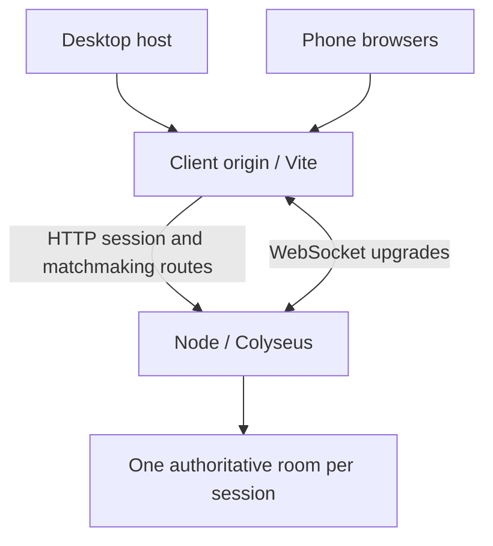

# Common Ground — Multiplayer Escape Room

Iteration 3 adds two cooperating teams to the phone-controlled escape room. A host displays the QR code on a large monitor. When the host starts, the server splits up to 20 players between the adjacent blue and orange chambers of the Twin Vaults. Each phone follows its player and shows their teammates. The desktop shows both rooms, every nickname, team rosters and connection counts.

## Requirements and quick start

- Node.js **24 LTS**, including Corepack
- pnpm **10.34.9**, pinned in `packageManager`
- A computer and phones on the same Wi-Fi for LAN testing

From the repository root:

```sh
corepack enable
corepack prepare pnpm@10.34.9 --activate
pnpm install --frozen-lockfile
cp .env.example .env
pnpm dev
```

`pnpm dev` builds shared exports first, then runs the shared TypeScript watcher, Vite, and the Node game server together. Ctrl+C stops all three. The small Node launcher forwards optional `--port`/`--host` arguments only to Vite.

- Client: port **5173**, listening on `0.0.0.0`
- Server: port **2567**, listening on `0.0.0.0`
- Health endpoint: `/health`

On the host, open **`http://YOUR_COMPUTER_WIFI_IP:5173`**, not localhost. For example, if your computer is `192.168.1.50`, open `http://192.168.1.50:5173`. Click **Create Game**. The QR points to `/join/ROOMCODE` at this same accessible origin. A localhost QR is deliberately refused, with setup guidance displayed in its place.

On Windows, copy `.env.example` to `.env` using Explorer or `Copy-Item .env.example .env`. If `corepack enable` cannot write system shims, use a writable shim directory or invoke `corepack pnpm` directly with the shims on your PATH. No npm or Yarn install commands are used for this project.

## Real-phone test

1. Find the computer's LAN IPv4 address: `hostname -I` on Linux, `ipconfig` on Windows, or Wi-Fi settings on macOS. Choose the Wi-Fi interface, not a Docker/VPN address.
2. Permit inbound TCP **5173** on your trusted private network. Disable guest-network/AP client isolation or use a network that allows devices to communicate. The default proxy means phones do not need direct access to port 2567.
3. Open the LAN URL on the desktop. Create a game and keep the original host tab open.
4. Scan the QR with at least five phones. Use different nicknames; verify all five names appear on the host. Try a duplicate nickname, including a different letter case: it should be rejected.
5. Start the game. Turn each phone sideways. Drag the bottom-left joystick in all eight directions. Check your team badge and teammates’ nicknames. Phones show only the assigned room. The host shows the complete map and both team rosters.
6. Walk against the perimeter, interior walls, crates, pillars, and blue closed doors: characters must stop at their feet and slide along edges. Walk into the central divider from each side. Both teams must stay in their own room. Check facing, walking animation, depth ordering, and subtle wall transparency around your character. Try opening the join link after starting: it should be rejected.
7. Briefly disable Wi-Fi on one phone, then restore it within 60 seconds. The character should freeze, appear faded to others, and return with its original ID, nickname, color, team, room and position. Refresh the phone page to test stored-token reconnection too.
8. Rotate to portrait while moving, switch tabs/apps briefly, and release/cancel a touch: movement should stop. Return to landscape to continue.
9. Temporarily disconnect and reconnect the host. The host must return to the overview without creating a character. **End game** closes the room for everyone.

Test on **physical Android Chrome and iPhone Safari**. Browser emulation and Node clients do not prove iOS safe-area, touch, keyboard, or background-tab behavior. The acceptance checklist is in [docs/testing.md](docs/testing.md).

Players are designed for phones; keyboard arrows/WASD remain available for developer testing. There is no unreliable user-agent gate preventing desktop test clients.

## URLs and WebSockets

All environment settings live in the root `.env`; Vite reads them through `envDir`, and Node loads them with `--env-file-if-exists`. Restart development after changing them. `VITE_*` settings are public build-time configuration: **never put host/reconnect tokens there**.

| Setting                            | Default                 | Purpose                                                                                                  |
| ---------------------------------- | ----------------------- | -------------------------------------------------------------------------------------------------------- |
| `VITE_PUBLIC_CLIENT_URL`           | Current browser origin  | Absolute origin used in QR links, e.g. `http://192.168.1.50:5173` or an HTTPS tunnel URL                 |
| `VITE_GAME_SERVER_URL`             | Current browser origin  | Optional separate HTTP(S) or WS(S) server origin; the client derives matching HTTP and WebSocket schemes |
| `HOST`                             | `0.0.0.0`               | Node listen interface                                                                                    |
| `PORT`                             | `2567`                  | Node listen port                                                                                         |
| `DEV_SERVER_TARGET`                | `http://127.0.0.1:2567` | Vite's upstream Node server, reachable from the computer                                                 |
| `CLIENT_ORIGINS`                   | Blank                   | Exact comma-separated permitted browser origins; set this for public deployments                         |
| `DEV_ALLOWED_HOSTS`                | Blank                   | Exact allowed Vite tunnel hostnames, comma-separated                                                     |
| `DEV_HTTPS_KEY` / `DEV_HTTPS_CERT` | Blank                   | Optional local TLS certificate paths, relative to `apps/client` or absolute                              |

The default same-origin arrangement is:



Vite proxies `/api`, `/matchmake`, `/health`, and Colyseus room WebSocket paths. With a separate backend, set `VITE_GAME_SERVER_URL` to its device-accessible origin, allow its port, and configure `CLIENT_ORIGINS` to the client origin. Never put `localhost` in a phone's server URL. The client refuses mixed HTTPS-client/HTTP-server configuration. Deployment assumes the client is served at the origin root, not a URL subdirectory.

## HTTPS testing

Basic rendering, touch events, and WebSockets do not require fullscreen or a secure context. Some browser features, including clipboard access and orientation-related APIs, are restricted or vary by platform. Use trusted **HTTPS + WSS** for realistic iPhone/Android testing. The optional Expand button runs only after a user gesture and only when fullscreen is advertised; failures are harmless. Manual rotation and `100dvh`/safe-area layout are the baseline.

### Option A: temporary HTTPS tunnel

Install [Cloudflare's `cloudflared`](https://developers.cloudflare.com/tunnel/get-started/) separately, then:

```sh
pnpm dev
# In another terminal:
cloudflared tunnel --url http://localhost:5173
```

Copy the returned HTTPS hostname, then set, using the actual returned values:

```dotenv
VITE_PUBLIC_CLIENT_URL=https://YOUR-TUNNEL.trycloudflare.com
VITE_GAME_SERVER_URL=
DEV_ALLOWED_HOSTS=YOUR-TUNNEL.trycloudflare.com
CLIENT_ORIGINS=https://YOUR-TUNNEL.trycloudflare.com
```

Restart `pnpm dev` while leaving the tunnel running. Open the **HTTPS tunnel URL on the host** and create a new room. The same tunnel carries matchmaking and WebSockets, so there is no second tunnel to configure. A quick tunnel temporarily exposes this development application to anyone with its URL; stop it after testing. See [Cloudflare Quick Tunnels](https://developers.cloudflare.com/tunnel/get-started/quick-tunnels/).

### Option B: trusted local certificate

Install [mkcert](https://github.com/FiloSottile/mkcert), then substitute the computer's real LAN IP:

```sh
mkdir -p .certs
mkcert -install
mkcert -key-file .certs/lan-key.pem -cert-file .certs/lan.pem 192.168.1.50 localhost 127.0.0.1
```

Set `DEV_HTTPS_KEY=../../.certs/lan-key.pem`, `DEV_HTTPS_CERT=../../.certs/lan.pem`, `VITE_PUBLIC_CLIENT_URL=https://192.168.1.50:5173`, and `CLIENT_ORIGINS=https://192.168.1.50:5173`. Leave `VITE_GAME_SERVER_URL` blank. Restart development and open the HTTPS LAN URL.

The phones must also trust mkcert's root CA certificate. On iOS, install its certificate profile and enable full trust in **Settings → General → About → Certificate Trust Settings**. Follow the [mkcert mobile instructions](https://github.com/FiloSottile/mkcert#mobile-devices); distribute only `rootCA.pem`, **never `rootCA-key.pem`**. Certificates and keys are gitignored. Untrusted certificate warnings are not a reliable secure-context test.

## Workspace and responsibilities

```text
apps/
  client/src/
    pages/                 Home, join, lobby, and live game screens
    components/            QR, player list, Phaser lifecycle boundary
    game/
      scenes/              World camera/map and separate screen-space controls
      entities/            Feet-anchored colored explorers, animation, labels
      world/               Isometric floor, segmented walls, objects, occlusion
      controls/            Eight-direction joystick and throttled input sender
      network/             Colyseus connection, session tokens, snapshot buffer
    hooks/                 Routing and low-frequency connection subscriptions
  server/src/
    rooms/                 Session lifecycle, admission, host permissions
    state/                 Colyseus schemas
    systems/               Fixed-step movement, spatial collision index, safe spawns, identity
packages/
  shared/src/
    types/                 Renderer-independent state/input/session contracts
    constants/             Movement settings, rates, limits, colors
    world/                 Projection, logical geometry types, validated Tiled loader
    maps/                  Editable Tiled JSON and original editor tileset
scripts/dev.mjs            Starts and cleans up all development processes
.github/workflows/ci.yml   Frozen install, lint, types, tests, build
```

Shared package dependencies use `workspace:*`; imports resolve to built ESM and declaration files. The root build runs in dependency order. There is exactly one `pnpm-lock.yaml`.

React owns navigation, forms, lobby/QR, and connection status. A small external store emits only roster/status changes, **never position changes**. Phaser owns rendering, cameras, the joystick, and interpolation. Phaser is loaded on entry to the game, initialized once per mounted canvas, and destroyed with its listeners and resize observer on unmount. React StrictMode is enabled.

### World coordinates, maps, and rendering

The server owns a **1664 × 896 logical-unit** plane. Each logical tile is a 64 × 64 square, projected as a 64 × 32 diamond. `worldToScreen`, `screenToWorld`, `tileToWorld`, and `worldToTile` live in `packages/shared/src/world/projection.ts`. World origin projects to screen origin; screen X may be negative. Character positions always describe their **feet**.

`screenInputToWorld` inversely projects joystick/keyboard directions and restores their original magnitude. Full-strength movement is 200 logical units/second in every direction, including diagonals. The 2:1 projection naturally compresses vertical screen travel. Only normalized logical direction and sequence number are transmitted; clients never submit authoritative positions.

Both applications load `twin-vaults.json` through the shared Tiled loader. Colyseus synchronizes the map ID and content fingerprint, session status, and the player, team and door records authorized for each connection. Static geometry is bundled once. A stale client refuses a mismatched map and displays an update/refresh error. Deploy client and server builds together; changing a running server ends its in-memory sessions.

Phaser draws muted geometric floors and cuboids once, reuses small color-baked character textures (works with WebGL and Canvas), and animates body/boots without allocating sprites each frame. Objects are anchored at the center of their base, characters at their feet; screen Y derived from logical X + Y determines depth. Long walls are split into tile-sized segments. Nearby walls/objects overlapping the local character fade to 27% opacity. Name labels remain above geometry for overview readability. No additional movement simulation runs in the client.

The player camera smoothly follows the local character with viewport-dependent zoom and the projected bounds of the assigned room; a separate scene keeps the joystick fixed. The host camera fits all rendered floor/wall bounds and recalculates on resize. Phaser uses CSS-pixel canvas dimensions and pointer coordinates at every device pixel ratio, avoiding oversized backing buffers on phones; nickname textures use up to 2× DPR for readability. Diamond-shaped room edges can expose background within a rectangular viewport. Fullscreen is optional.

### Collision and doors

`CollisionWorld` is server-only: a 64-unit spatial hash indexes explicit map AABBs. The character's feet have a **28 × 28 logical-unit square footprint**. Every fixed simulation step moves one axis at a time, clamps against nearby solid shapes and world bounds, and preserves sliding along the other axis. Displacements are subdivided into steps no larger than the footprint's half-width, preventing tunneling through thin obstacles. There is no 3D physics dependency and no collision inferred from tile colors or artwork.

The Tiled `Rooms` layer defines named, tile-aligned logical rectangles. Teams point to rooms by ID. The server clamps each axis to the assigned rectangle, inset by the footprint radius, for every collision substep. This rule still holds with the divider removed or a door open. A team session requires ten collision-free, separated spawn points inside each starting room. Both doors start `closed` in Colyseus state and their collision shapes reference stable door IDs. The collision query and renderer read server door state; **there is no message handler or UI to open doors** in this iteration.

See [docs/map-authoring.md](docs/map-authoring.md) to edit this map or add another using the supported Tiled format, and [asset licensing](packages/shared/src/maps/ASSETS.md) for the original geometric art.

### Team assignment and visibility

The host starts one synchronous transition. The server shuffles connected seats using Fisher–Yates with `crypto.randomInt`, then deals A, B, A, B. It shuffles temporarily disconnected seats separately and continues the deal, so both the active group and the full roster are balanced. With odd totals, A has the extra seat. Each team takes its starting room from Tiled metadata. The server writes positions and memberships, marks the game as playing, and updates permissions before the next patch. Repeated starts and departures leave the existing assignments in place.

A player stores one `teamId`. The corresponding `Team` stores the current `roomId`. The server derives membership and counts from those records. A valid reconnect token reclaims the server’s existing character, including when the phone missed the start while offline. The server rebuilds that connection’s view before it sends the full state.

| Connection | Lobby                                                            | Playing                                                 |
| ---------- | ---------------------------------------------------------------- | ------------------------------------------------------- |
| Host       | All seats and connection status                                  | Both rooms, teams, doors and all player positions       |
| Phone      | Shared roster of unassigned players with placeholder coordinates | Its team, that team’s players and the doors in its room |

Colyseus 0.17 / Schema 4 `StateView` filters entries of the `players`, `teams`, and `doors` maps in the encoder. Permissions change on join, start and reconnect. Normal movement uses the existing patch stream. Public Tiled geometry ships with the client. Store future private clues, solutions and changing object state on the server. Phaser builds only the authorized room’s floor and objects on a phone, even when the viewport extends past a wall.

### Network and session behavior

- One private Colyseus room per session; 8-character cryptographically random room codes (~40 bits), collision checked in the single process.
- Creating a session returns a separate 256-bit host token. Only its SHA-256 digest stays on the server. Host access is checked before joining; the authorized connection alone can start the game. Tokens never enter room state or QR URLs.
- Player IDs are server-generated UUIDs. Unicode-normalized, case-insensitive nicknames are unique, including disconnected reserved seats. Each player receives a unique color from the 20-color palette; names also identify players.
- Capacity is 20 player characters **plus one host connection**. Both admission and join commit validate status/capacity/nickname to handle concurrent requests. No new players after start; valid reconnections remain possible.
- Simulation uses a fixed **30 Hz** step; state patches run at **20 Hz**. Direction input is sent at up to **20 Hz** while moving and on stop. The server rejects invalid/non-finite/out-of-range directions and replayed sequence numbers, normalizes diagonals, resolves map/door collision and boundaries, limits input rate, and expires input after **300 ms**.
- Remote rendering interpolates snapshots approximately **100 ms** behind receipt. Local rendering follows the latest authoritative state with short smoothing. There is no client prediction in this iteration, so higher latency is noticeable.
- Colyseus issues and rotates reconnect tokens. SDK retries recover brief drops; a tab-scoped sessionStorage token supports page reloads for up to **60 seconds after disconnection**. Tokens are bound to the originating server and role. Only the live browser tab holds the host secret; another tab cannot gain host access from a room code.
- Input resets on blur, visibility changes, touch cancellation, portrait rotation, and disconnect. The server's timeout provides a fallback when a suspended browser cannot send a stop.
- Deliberate departure removes the player. Temporary drops preserve/fade the character. Losing the host beyond the grace window ends the room; clicking End game ends it immediately. Unclaimed rooms expire after roughly 65 seconds, idle rooms after 30 minutes, and all rooms after 4 hours.
- HTTP game creation and room lookup are rate-limited, room count is capped at 100, WebSocket messages are capped at 2 KB, and public generic room creation is disabled. This is a trusted-group MVP, not a complete internet abuse-prevention system. Put public deployments behind TLS and infrastructure-level connection/request limits.

`express` is installed because the chosen Colyseus WebSocket transport imports it at runtime as a peer. The application mounts a small Node-compatible HTTP handler through Colyseus's Express hook so application and matchmaking routes share one server without competing request listeners.

## Checks and build

```sh
pnpm lint
pnpm typecheck
pnpm test
pnpm build
```

`pnpm format` formats the workspace. Unit tests exercise projection, input validation, map loading, collision, spawn validation, team balance and permissions. Real WebSocket tests run with up to 20 player clients and an additional host. They inspect decoded state and incoming frames, exercise forged movement requests, and cover both player and host reconnection.

After building, run `pnpm test:browser` with Google Chrome installed (or set `CHROME_BIN` to a Chromium executable). This check opens the production UI, fills the session, moves a player with the joystick, rotates the phone viewport and reconnects through page reloads. CI runs the checks and saves the desktop and landscape screenshots under the `team-views` artifact. See [the verification guide](docs/testing.md).

### Run a production build locally

```sh
pnpm build
NODE_ENV=production pnpm start
```

In PowerShell, set `$env:NODE_ENV='production'` before `pnpm start`. Node serves both `apps/client/dist` and Colyseus on port 2567. Open the LAN IP at port 2567, or terminate HTTPS at a reverse proxy with WebSocket upgrades enabled. Build with a matching public client URL, or keep it blank to use the origin dynamically. This requires a persistent Node process; static-only hosting/GitHub Pages and request-only serverless functions cannot host this game server.

## Limitations and Iteration 4

State is in memory. A server restart ends all games, and tokens do not survive it. Reconnection after 60 seconds or from another browser is intentionally unsupported. Single-process hosting only; scaling would need shared matchmaking/presence and room-aware routing. There is no player-to-player collision, moderation UI, persistent identity, or native-app installation. Twenty colors are not equally distinguishable to everyone, so nicknames remain visible.

The map loader intentionally supports a small, validated Tiled subset: finite 64 × 32 isometric maps, three embedded floor tiles, uncompressed arrays, unrotated rectangle objects, and point spawns. External tilesets, infinite maps, groups, flips, polygons, rotated objects, and arbitrary tile artwork are not supported. The included atlas is an editor aid; the runtime generates matching geometric art. Complex overhanging geometry will need richer depth/occlusion rules than the current segmented AABBs. At small host resolutions or with clustered players, labels can overlap; the fixed overview and footer roster are the default. There is no local prediction, so high latency is visible. Physical iPhone/Android testing and performance measurements on mid-range phones remain required; see the verification record.

For the first cooperative puzzle, author stable object IDs and interaction areas in Tiled. Keep the symbol sequence and mechanism rules on the server. Accept an interaction request with an object ID and action, resolve the sender’s identity and room, and validate distance, game status and the allowed transition. A retry should return the existing result.

Attach team-private clue and mechanism state to the filtered team or room. Publish only the completion flags that both teams need. Once both objectives are complete, the server can change the shared progression state in a single transition. Reconnecting clients will receive the current result through their normal filtered snapshot.

Reference APIs: [Tiled JSON format](https://doc.mapeditor.org/en/stable/reference/json-map-format/), [Tiled isometric object coordinates](https://doc.mapeditor.org/en/stable/manual/layers/#object-layers), [Phaser cameras](https://docs.phaser.io/phaser/concepts/cameras), [Colyseus 0.17 reconnection](https://0-17.docs.colyseus.io/room/reconnection), [Vite server/proxy configuration](https://vite.dev/config/server-options.html), [Screen orientation support](https://developer.mozilla.org/en-US/docs/Web/API/ScreenOrientation/lock).
