# Iteration 5 — Five levels, hidden chambers and the Proverbs 4 quest

Baseline note: Iteration 4B (asset integration and the first puzzle) had not been pushed —
`main` ended at the art-asset pack of Iteration 4A. This iteration therefore also integrates the
existing Adventure Comic art into the live game and implements the Secret Code puzzle.

## The two quest lines

| Level | Name                | Main puzzle                                                               | Verses A | Verses B |
| ----- | ------------------- | ------------------------------------------------------------------------- | -------- | -------- |
| 1     | The Secret Code     | Team A reads symbol → digit; Team B enters the 4-digit code               | 3        | 2        |
| 2     | The Mirror Chamber  | Team A's levers move lamps only Team B sees, beside the target            | 2        | 3        |
| 3     | The Ancient Library | Team A reads the order on two tablets; Team B presses pedestals           | 3        | 2        |
| 4     | The Balance Chamber | Each team loads its pan: level beam at the shared target                  | 3        | 3        |
| 5     | The Final Mechanism | Each team sets the pattern only the other can read; both press within 6 s | 3        | 3        |
| Final | The Hall of Wisdom  | Everyone arranges the 27 cards in biblical order                          | 14       | 13       |

An exit opens only when the level's puzzle is solved **and** every verse of that level has been
collected (`GameRoom.updateExits`). The level ends when each team has one connected player in
its own exit alcove. Winning requires the correct final sequence (`GameRoom.win`).

Puzzles are server-generated from the session seed and always solvable; solutions never leave
`apps/server/src/systems/puzzles.ts` except as the asymmetric view each team needs.

## Where things live

| Concern                                          | Location                                                                                                            |
| ------------------------------------------------ | ------------------------------------------------------------------------------------------------------------------- |
| Public level maps (Tiled)                        | `packages/shared/src/maps/` — level 1 is `twin-vaults.json`; levels 2–5 are generated by `scripts/build-levels.mjs` |
| Public props per level                           | `packages/shared/src/game/levels.ts`                                                                                |
| Hidden chambers, container contents, hiding plan | `apps/server/src/content/secrets.ts` (**server only**)                                                              |
| Scripture dataset and loader                     | `apps/server/content/scripture/`, `apps/server/src/content/scripture.ts`                                            |
| Seeded placement manifest and reachability gate  | `apps/server/src/systems/placement.ts`                                                                              |
| Puzzle engines                                   | `apps/server/src/systems/puzzles.ts`                                                                                |
| Final board                                      | `apps/server/src/systems/board.ts`                                                                                  |
| Authorization table for filtered state           | `apps/server/src/systems/visibility.ts`                                                                             |
| Room orchestration                               | `apps/server/src/rooms/GameRoom.ts`                                                                                 |

## Hidden chambers

A chamber is a separate small map section with its own collision world and local coordinates.
It is not part of any public map, so it cannot connect the two teams' rooms.

- **Discovery.** Entrances are ordinary-looking public props (a bookshelf, a carved stone, an old
  wardrobe, a torch bracket). Near one, the server offers that player a contextual action and a
  subtle hint. The first use uncovers it for that player only; the second enters.
- **Inside.** The player's public `x/y` freezes at the doorway and `exploring` becomes true. The
  real position lives in a separate `Explorer` object that is granted only to clients standing
  in the same chamber. Chamber geometry is sent as a targeted message to players inside it.
- **Host.** The host receives neither geometry nor positions nor contents — only the roster flag
  ("exploring"). This is enforced by Colyseus state views and targeted messages, not by hiding
  sprites.
- **Leaving.** Every chamber has an exit prop; reachability of the exit, the entrance and every
  item is verified by flood fill before a session is accepted.

Containers (chests, cabinets, bookshelf compartments) reveal their contents to a player only
after that player opens them from within reach. Collection is validated again (reach, opened by
this player, own team, current level) and is atomic.

## Network messages

Client → server: `interact {id}`, `collect {id}`, `puzzle {id, …}`, `board {op, …}`.
Server → one client: `prompt`, `panel`, `area`, `discoveries`, `notice`.
Everything else is schema state, filtered per client by `syncVisibility`.

The final board accepts `place {card, slot, expect}`, `remove {card}` and `submit`. `expect` is
the card the mover saw in the destination slot; if it has changed the move is rejected, so two
phones can never silently overwrite each other. Placing onto an occupied slot swaps (from a slot)
or returns the occupant to the tray (from the tray) in one step.

## Pacing instrumentation

The server records, per level, seconds to puzzle completion, to the last verse and to the exit,
plus final-puzzle and total durations (`state.stats`, logged as `[pacing]` in production). There
is deliberately no countdown yet.

## Reproducible sessions

`GAME_SEED` fixes verse placement, puzzle solutions and the final tray order; `TRANSITION_MS`
shortens level transitions for tests.

## Screenshots

Captured from the running production build by `pnpm test:browser` (headless Chromium, Canvas
renderer). They show the **placeholder deck**, because the licensed verse text could not be
downloaded in the build environment — see [the Scripture notes](scripture/README.md).

|                                                                                         |                                                                                  |
| --------------------------------------------------------------------------------------- | -------------------------------------------------------------------------------- |
| 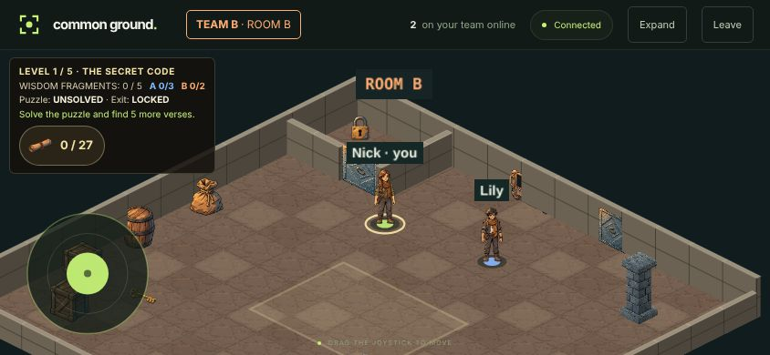                  | 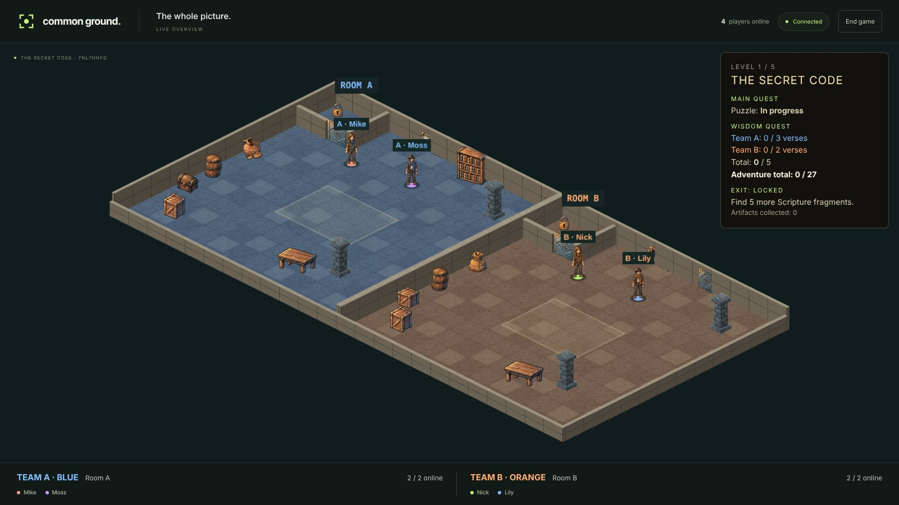                   |
| 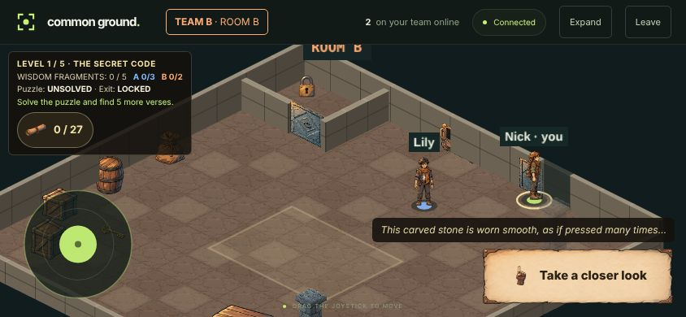 | 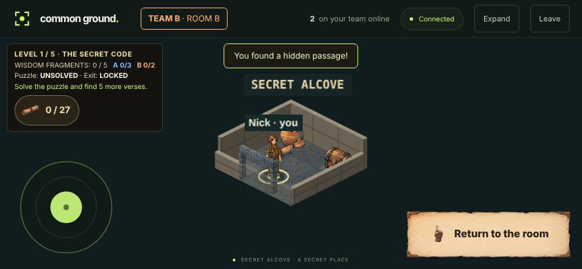        |
| 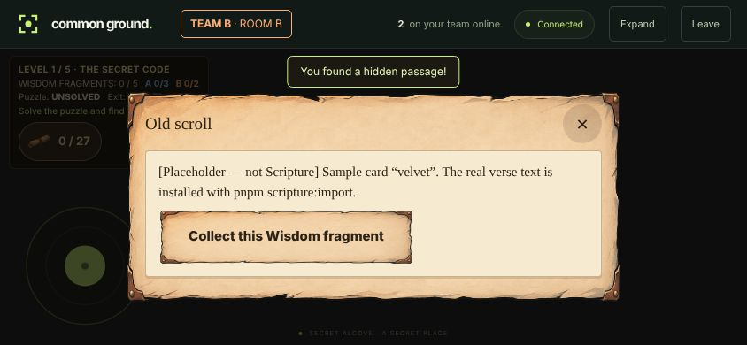             | 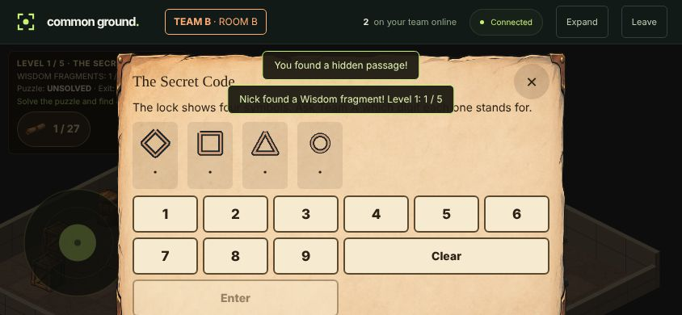 |
| 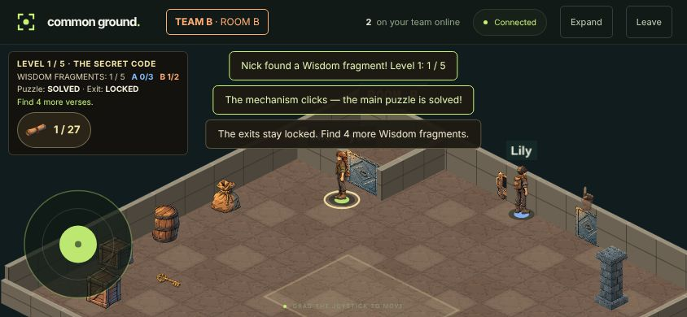         | 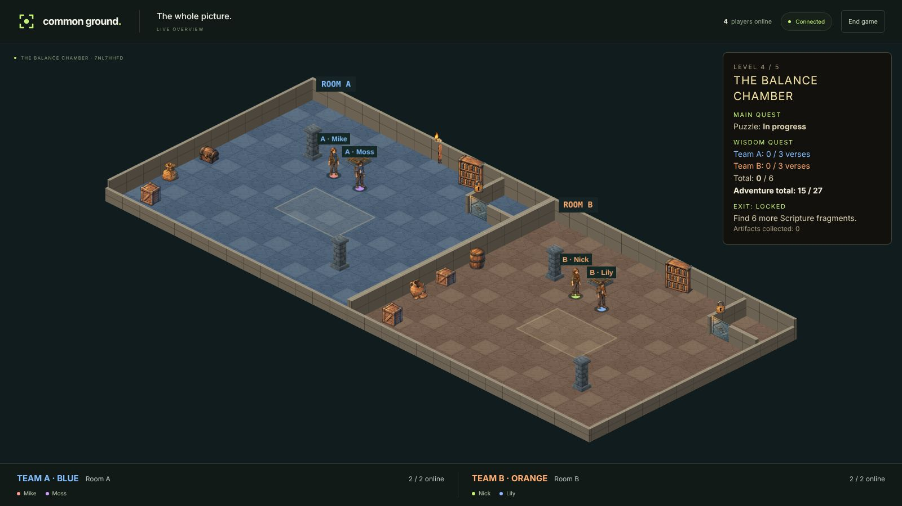           |
| 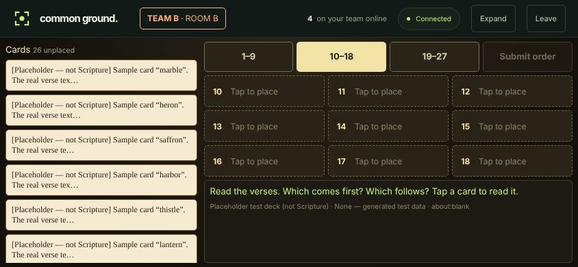             | 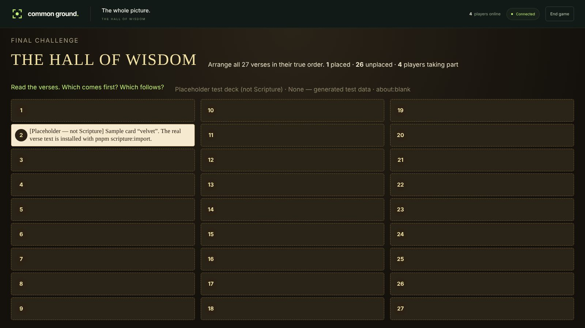      |

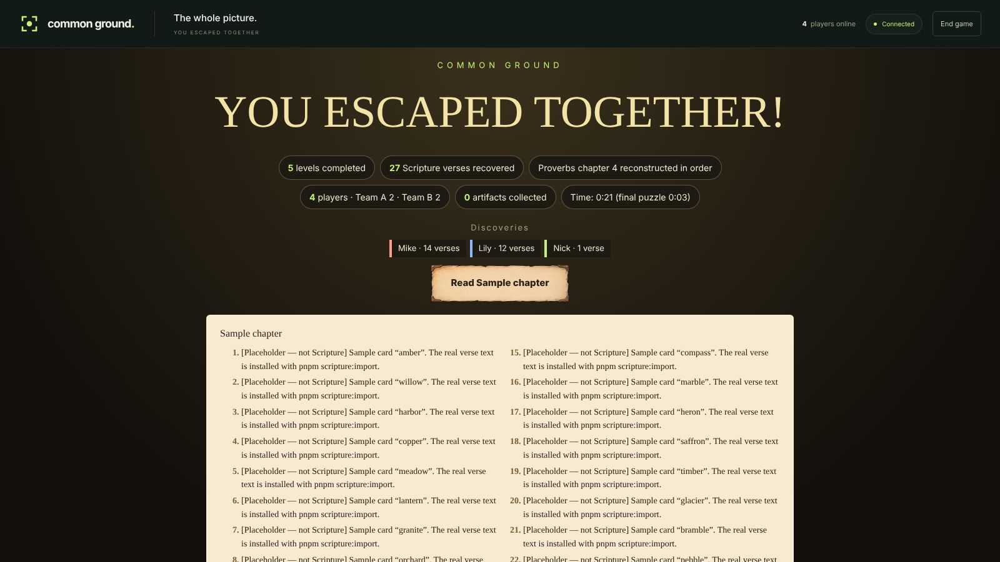
