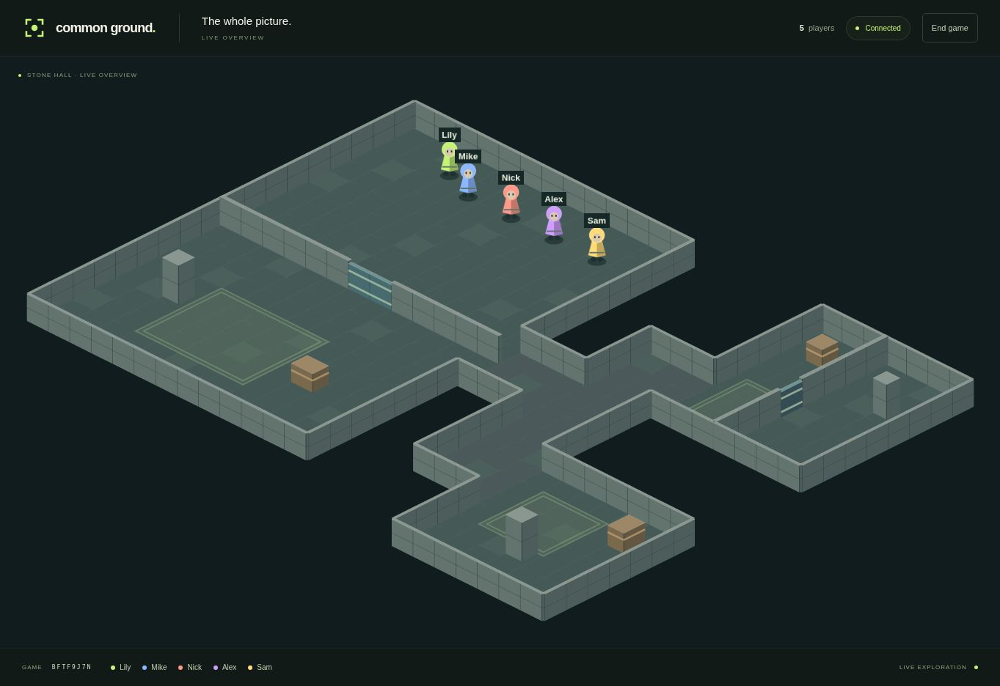
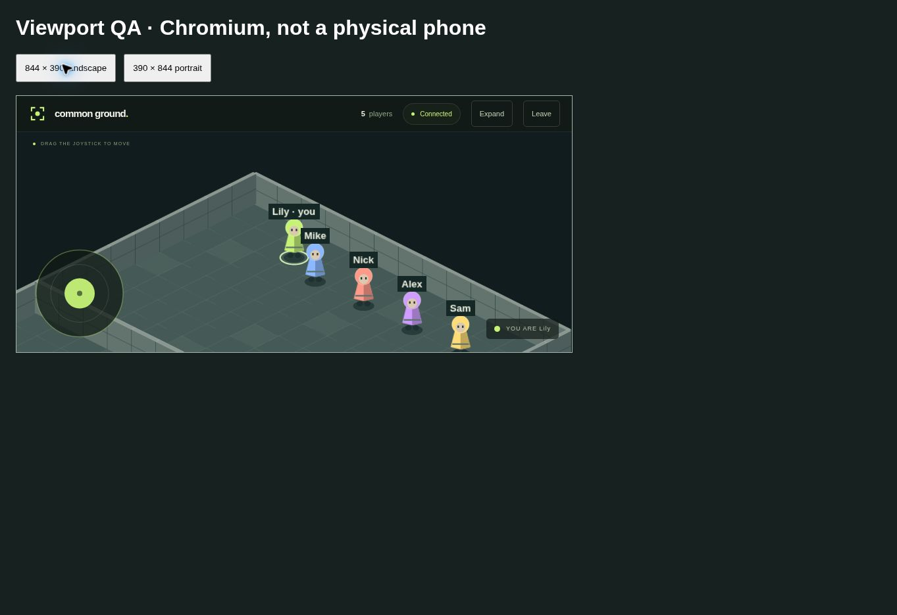

# Verification guide

## Iteration 3

The unit and real WebSocket suite exercises the lobby-to-game transition, shuffling, reserved seats, capacity, room selection, safe spawns and movement. One test removes all physical colliders and checks the player footprint against arbitrary room bounds. Others drive forged inputs toward both sides of the actual divider and exercise the existing wall, crate and door collisions.

The full-capacity test compares each of 20 SDK clients’ decoded state with the host’s authoritative roster. Each phone sees ten players, one team and its own door. A separate test captures bytes arriving at the SDK before decoding, checks the first playing patch, and verifies that a known float coordinate reaches the host and teammates only. Reconnection tests cover a moved character, a missed start, the host, and subsequent permanent departures.

Run `pnpm lint`, `pnpm typecheck`, `pnpm test`, and `pnpm build`. After building, `pnpm test:browser` starts an ephemeral production server and opens Chrome with a desktop host and a landscape player. Nineteen SDK players fill the remaining seats. The browser check covers the QR join flow, counts, pointer joystick movement observed by a teammate, rotation, and player/host reloads. CI saves both screenshots in the **team-views** artifact.

Physical Android Chrome and iPhone Safari acceptance is pending. Check safe areas, touch cancellation, background/resume, Wi-Fi recovery and sustained frame rate on the intended phones using the [real-phone checklist](../README.md#real-phone-test).

## Historical Iteration 2 browser checks

Chromium checks recorded on the original Stone Hall:

- Host creation, QR/join URL, and five player browser connections in the lobby.
- Host start, the full isometric overview with all five colored characters, and player follow view.
- Pointer-operated joystick movement in screen space and camera following.
- A temporary iframe harness with **844 × 390** landscape and **390 × 844** portrait viewports: canvas/UI fit, fixed joystick, responsive resizing, and rotate-device warning. The harness was removed after testing.
- Player and host page reloads reconnect to the running game; the roster stays at five and the moved character returns.
- No application-origin console errors in the final player check. Browser-extension diagnostic errors were unrelated to the app.
- Canvas fallback initially exposed unsupported sprite tinting; color is now baked into reusable textures and was visually rechecked.

These are browser viewport checks, **not physical-device tests**. Device DPR/safe areas, true touch cancellation, Safari behavior, Wi-Fi recovery, battery usage, and sustained 20-player frame rate still need physical Android/iPhone validation.

